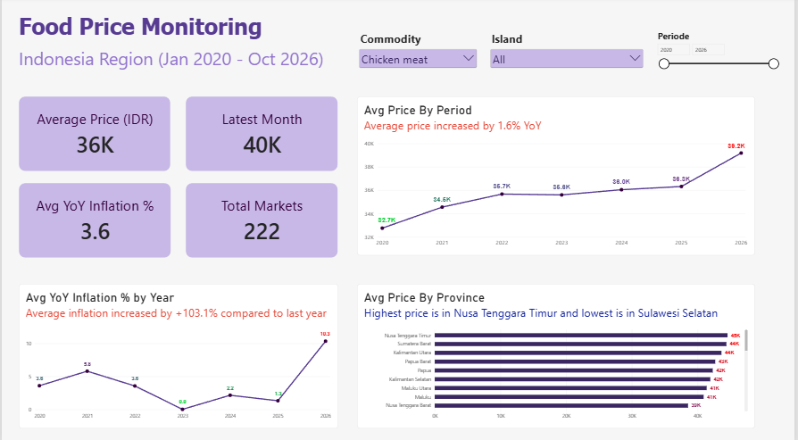

# Indonesia Food Price Monitoring

An end-to-end data engineering and analytics project that processes Indonesian food price data into an analytical data warehouse and an interactive Power BI dashboard.

The project aims to monitor food price trends across Indonesian regions, analyze year-over-year inflation, and explore price variations across commodities and provinces.

## Dashboard Preview

*Power BI dashboard showing food price trends from January 2020 to October 2026.*

## Project Overview

This project demonstrates a data pipeline that transforms raw food price data into structured, analysis-ready datasets.

The workflow covers data ingestion, cleaning, transformation, data warehouse modeling, and data visualization.

## Data Pipeline Architecture

The project follows a layered data processing approach:

1. **Source Data** – Raw food price data obtained from the World Bank.
2. **Data Cleaning (Python)** – Cleaning and preparing the raw dataset for further processing.
3. **Staging Layer (SQL Server)** – Loading cleaned data into the staging table.
4. **Gold Layer (SQL Server)** – Building analytical dimension and fact tables using a Star Schema.
5. **Data Visualization (Power BI)** – Connecting to the Gold Layer to create an interactive dashboard.

## Data Warehouse Design

The Gold Layer consists of the following tables:

| Table | Description |
|---|---|
| `gold.dim_area` | Geographic information, including province, city, market, and coordinates. |
| `gold.dim_commodity` | Commodity information and category classification. |
| `gold.dim_date` | Date attributes for time-based analysis. |
| `gold.fact_price` | Food price observations and related indicators. |

The fact table is connected to the dimension tables through surrogate keys to support analytical queries.

## Dashboard Features

The Power BI dashboard provides the following insights:

### Key Performance Indicators (KPIs)
- **Average Price (IDR):** Average observed food price.
- **Latest Month:** Average price for the latest available period.
- **Average YoY Inflation (%):** Average year-over-year inflation.
- **Total Markets:** Number of markets included in the dataset.

### Interactive Analysis
- Commodity filter to explore individual food commodities.
- Island filter to compare regional price patterns.
- Period slicer to analyze selected time ranges.

### Data Visualizations
- Average Price by Period: Tracks food price trends over time.
- Average YoY Inflation by Year: Shows annual inflation patterns.
- Average Price by Province: Compares average food prices across provinces.

## Tools & Technologies

- **Python** – Data cleaning and preprocessing.
- **SQL Server** – Data staging, transformation, and data warehouse development.
- **Power BI** – Data modeling, DAX measures, and interactive dashboard development.
- **Git & GitHub** – Version control and project documentation.

## Data Source and Attribution

This project uses food price data obtained from the World Bank Microdata Library.

**Source:** World Bank, *Indonesia Food Price Estimates*

**Dataset URL:** [https://microdata.worldbank.org/catalog/6166](https://microdata.worldbank.org/catalog/6166)

The data was used for educational and portfolio purposes. Data cleaning, transformations, and analytical methods were performed as part of this project.

Please refer to the original dataset metadata and the World Bank's applicable terms of use for the required attribution wording, third-party restrictions, and reuse conditions.

This project is an independent analysis and is not affiliated with or endorsed by the World Bank.

## Project Purpose

This project was developed as a practical learning exercise to strengthen skills in:

- Data ingestion and preprocessing.
- Data cleaning and transformation.
- SQL-based data warehouse development.
- Dimensional modeling and Star Schema design.
- Analytical data preparation.
- Business intelligence and data visualization.